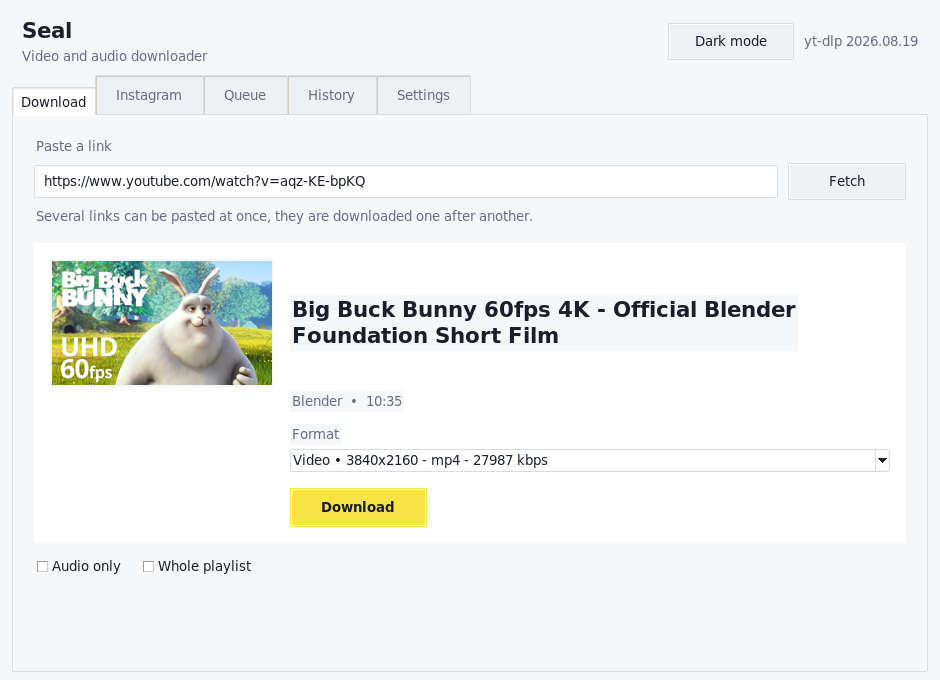

# Seal for Windows

A video, audio and Instagram downloader for Windows. It is a small desktop application that
wraps [yt-dlp](https://github.com/yt-dlp/yt-dlp) and
[instaloader](https://github.com/instaloader/instaloader), everything happens on the machine of
the user, no server is involved.



## Features

- Download videos and audio files from every site that yt-dlp supports.
- Pick the format, the resolution or extract the audio track.
- Several links at once, they are downloaded one after another.
- A queue that shows the progress, the speed and the remaining time.
- Download photos, reels, igtv and whole profiles from Instagram.
- A history of everything that was downloaded.
- Light and dark theme.

## Running it from the sources

Python 3.10 or newer is needed, [tkinter](https://docs.python.org/3/library/tkinter.html) is
part of the standard distribution on Windows.

```bat
git clone https://github.com/JunkFood02/Seal.git
cd Seal\desktop
python -m venv .venv
.venv\Scripts\pip install -r requirements.txt
.venv\Scripts\python -m seal
```

The `run.bat` script does the same thing and creates the virtual environment when it is
missing.

## Building the executable

```bat
build_windows.bat
```

The script installs the dependencies, runs the tests and builds `dist\Seal.exe` with
[PyInstaller](https://pyinstaller.org). The executable contains yt-dlp and instaloader, only
`ffmpeg` has to be installed on the machine, it is needed to merge the streams of a video and
to convert the audio.

The GitHub action `windows.yml` does the same on every push, the executable is uploaded as an
artifact.

## YouTube asks for a login

YouTube shows a "Sign in to confirm you're not a bot" message for many videos, especially when
the network is shared or a server. The application says so and the cookies of the browser solve
it:

1. Sign in to YouTube in your browser.
2. Open the settings of the application and choose **Cookies from browser** (`chrome`, `edge`,
   `firefox`, …).
3. Read the link again.

The cookies are read by yt-dlp directly from the browser, the application never sees them.

## Instagram

Instagram asks for a login for most of the content. The application never stores a password:

- Public posts, reels and profiles are downloaded without a login.
- Stories and private posts need a session file. It is created once with
  [instaloader](https://github.com/instaloader/instaloader) and then selected in the settings:

  ```bat
  python -m instaloader --login your-account
  ```

  The path of the file (for example `%USERPROFILE%\.config\instaloader\session.json`) is
  written into the settings of the application.

## The settings

The settings are stored in `%LOCALAPPDATA%\Seal\config.json`, the history of the downloads is
written to `%LOCALAPPDATA%\Seal\history.json`.

| Setting | What it does |
| --- | --- |
| Downloads are saved in | The folder the videos are written to |
| Audio files are saved in | The folder the audio files are written to |
| Name of the downloaded files | The template yt-dlp uses, `%(title).200B.%(ext)s` by default |
| Audio format | `m4a`, `mp3`, `opus`, … |
| Videos are merged into | `mkv`, `mp4` or `webm` |
| Write the metadata into the file | Adds the title, the artist and the cover |
| Embed the thumbnail | Writes the cover into the file |
| Download the subtitles | Downloads the subtitles of the video |
| Proxy | Sends the traffic through a proxy |
| Maximum speed | Limits the speed of the download, for example `2M` |
| Cookies from browser | The browser the cookies are taken from, YouTube asks for a login for most of the videos |
| Cookies file | A cookies file of your browser, some sites ask for a login |
| Extra arguments for yt-dlp | Anything that is not covered by the settings above |
| Session file | The session of instaloader, it is needed for the stories of instagram |

## The tests

```bat
.venv\Scripts\python -m pytest tests -q
```

`tools/smoke_test.py` starts the application, reads a link, starts a download and writes a
screenshot of every tab. It needs a display.
